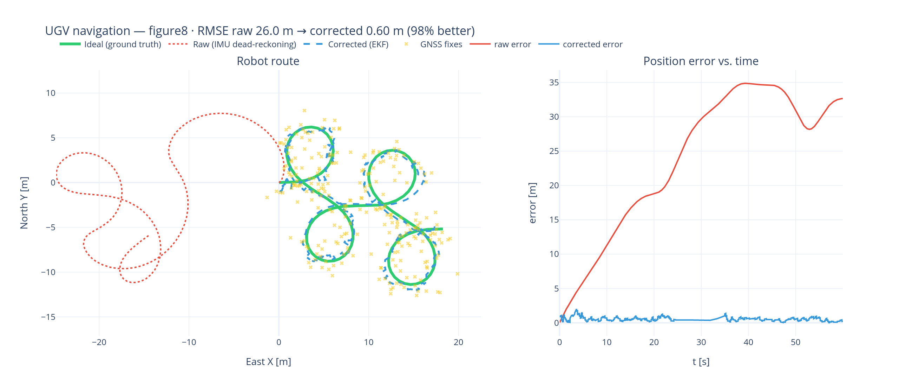
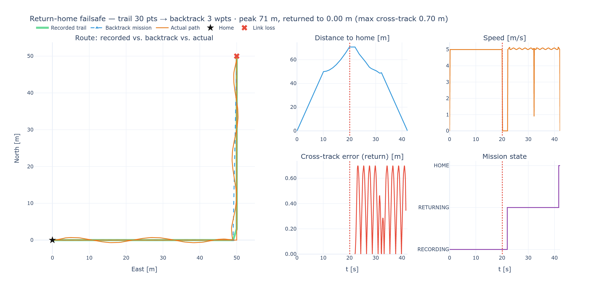

# NavStand — Analytic Project Report

**A Reproducible Simulation & Evaluation Stand for Odometry and GNSS/INS
Navigation of Ground Robotic Complexes**

| | |
|---|---|
| **Domain** | Mobile‑robot state estimation / sensor fusion |
| **Stack** | ROS 2 Jazzy · Gazebo Harmonic · C++20/23 · Python (Dash/Plotly) |
| **Toolchain** | Clang 19 · CMake · Ninja · GoogleTest · Docker / Dev Containers |
| **Reference** | KF‑GINS (i2Nav‑WHU) |
| **Scope** | Stage 1 — classical estimation (ML explicitly deferred to Stage 2) |

---

## 1. Abstract

NavStand is a fully containerised, reproducible software stand for **modelling,
researching and visualising** the odometry and navigation of a ground robotic
complex (GRC/UGV). It couples a physically‑simulated robot (Gazebo Harmonic)
carrying **IMU**, **GNSS** and **wheel‑odometry** sensors with a modern C++23
estimation core implementing an **Error‑State Kalman Filter (ESKF)** for
loosely‑coupled GNSS/INS fusion. A deterministic **fault injector** corrupts the
sensor streams with configurable noise, bias, outages and wheel slip; a
**metrics** node computes navigation‑accuracy statistics against ground truth;
and two **Plotly/Dash dashboards** visualise the ideal, raw and corrected
trajectories together with the supporting infographics.

Two results are reported, and they come from two different estimators — they
must not be conflated:

* the **planar Python EKF** of the interactive simulator reduces position RMSE
  by **93–98 %** relative to raw inertial dead‑reckoning across the tested
  motion profiles (§5.1);
* the **C++ ESKF running in the Gazebo stack** tracks ground truth on the
  nominal scenario E01 to under 0.1 m horizontally (§5.4).

---

## 2. Objectives

1. Build a **reproducible** experimentation environment (single Docker image,
   pinned toolchain and dependencies).
2. Simulate a UGV with realistic, corruptible **IMU/GNSS/wheel** sensors.
3. Implement a **classical GNSS/INS fusion** estimator using modern C++
   (modules, namespaces, advanced STL, OOP) validated by unit tests.
4. Provide **automatic metric computation** and **interactive visualisation** of
   the ideal, raw and corrected robot routes.
5. Cross‑check the estimator concept against the published **KF‑GINS**
   reference.

---

## 3. System architecture

Nine ROS 2 packages plus a standalone Python simulator:

```
Gazebo Harmonic ──(ros_gz bridge)──► /imu /gps /wheel /ground_truth
        │                                   │
        ▼                                   ▼
 ugv_fault_injector ──► /sensors/* ──► ugv_localization (ESKF) ──► /localization/odom, /path
                                            │                          │
                       ugv_bringup (baseline: robot_localization)      ▼
                                            └──────────────► ugv_metrics ──► data.csv + metrics.json
                                                                              │
                                                                              ▼
                                                                      ugv_dashboard (Dash)
```

| Package | Responsibility |
|---|---|
| `ugv_nav_core` | **C++23 module** core: types, attitude/geodesy math, ESKF, sensor models, metrics + GoogleTest suite |
| `ugv_description` | UGV URDF/xacro with IMU + GNSS links |
| `ugv_gazebo` | Gazebo world, `ros_gz` bridge, spawn/launch |
| `ugv_sensor_processing` | Wheel‑odometry (differential‑drive) node |
| `ugv_fault_injector` | Deterministic sensor corruption (noise/bias/outage/slip) |
| `ugv_localization` | Online **ESKF** estimator node |
| `ugv_metrics` | Time‑alignment + accuracy metrics (CSV/JSON) |
| `ugv_bringup` | Trajectory commander, operator-heartbeat link, `robot_localization` baseline, top‑level launch |
| `ugv_dashboard` | Results viewer **+ interactive GNSS/IMU simulator** |
| `ugv_return_home` | **C++23 return‑home‑on‑link‑loss failsafe** (ArduPilot/MAVLink) |

### 3.1 Modern‑C++ design highlight

The core is written as a **C++23 named module** `ugv.nav.core` (partitions:
`types`, `math`, `sensors`, `eskf`, `metrics`). Because ROS 2 links against
`libstdc++` while the modules are cleanest under `libc++`, the core is exposed to
ROS nodes through an **ABI‑stable header facade** (`ugv_nav_core.hpp`) backed by
a shared library — the modules are compiled once into a static archive and hidden
behind the facade. This lets the project use bleeding‑edge language features
without breaking ROS interoperability.

---

## 4. Methodology

### 4.1 Sensor models

* **IMU** — body specific force `[a_forward, a_lateral] = [dv/dt, v·ω]` and
  yaw‑rate `ω`, each augmented with a constant **bias** and Gaussian **noise**.
* **GNSS** — geodetic fix converted to a local NED frame, with Gaussian
  position noise and configurable **outage** windows.
* **Wheel odometry** — differential‑drive forward kinematics from joint states.

### 4.2 Estimator — Error‑State Kalman Filter

The online node runs a **15‑state ESKF** (position, velocity, attitude error,
accel bias, gyro bias) with IMU‑driven propagation and loosely‑coupled GNSS
position updates plus wheel‑speed and non‑holonomic (zero lateral/vertical body
velocity) updates — the standard KF‑GINS‑style architecture.

**Frames.** The filter core works in the aerospace convention (NED navigation
frame, FRD body); ROS uses ENU/FLU (REP‑103). `eskf_node` is the single place
where they meet: IMU samples are converted FLU→FRD on input, and the state is
published as an ENU pose with an FLU body twist (REP‑105).

**Attitude error.** The error is a *global* (nav‑frame) rotation vector,
`R_true = Exp(δφ)·R_est`; `F`, every `H` and the injection all use that one
convention.

**Heading.** Position‑only GNSS cannot observe yaw at rest. The start heading is
therefore a parameter (`init_yaw_deg`, `init_yaw_std_deg`); if it is declared
unknown (σ ≥ 45°) the node runs on IMU + GNSS only until the vehicle has rolled
`align_distance` metres, then aligns to the GNSS course over ground and enables
the wheel/NHC updates.

For the interactive simulator (planar, real‑time in the browser) the same design
is expressed as a compact **8‑state EKF**
`[pₓ, p_y, θ, vₓ, v_y, b_aₓ, b_a_y, b_gz]`:

* **Predict** (every IMU sample): rotate bias‑corrected body acceleration into
  the navigation frame, integrate velocity and position, propagate the yaw with
  the bias‑corrected gyro, and update the covariance with the analytic Jacobian.
* **Update** (every GNSS fix): loosely‑coupled position correction
  `H = [I₂ | 0]`, standard Kalman gain.

The **raw** trajectory uses identical IMU integration **without** bias estimation
or GNSS updates, isolating the value added by the filter.

### 4.3 Fault injection & experiment matrix

A deterministic, seed‑controlled injector reproduces twelve scenarios (E01–E12)
spanning nominal operation, GNSS noise/outage, IMU noise/bias, odometry
noise/scale error, wheel slip, and a combined worst case.

### 4.4 Metrics

`ate` (absolute trajectory error), position/velocity/yaw **RMSE**, **max error**,
**RPE** (relative pose error) and travelled distance — computed in C++ and
emitted as `metrics.json`, and re‑derived in Python for the simulator cards.

---

## 5. Results

### 5.1 Estimator performance across motion profiles

Interactive simulator, 40 s runs, GNSS outage 15–23 s, seed 42:

| Route | RMSE — raw (m) | RMSE — corrected (m) | Improvement |
|---|---:|---:|---:|
| figure‑8 | 40.15 | 1.76 | **95.6 %** |
| circle | 32.86 | 0.64 | **98.0 %** |
| square | 15.88 | 0.73 | **95.4 %** |
| spiral | 12.66 | 0.82 | **93.5 %** |
| s‑curve | 40.14 | 1.07 | **97.3 %** |

### 5.2 Qualitative view (figure‑8, GNSS outage 25–35 s)



* **Left** — the green ideal route, the red raw dead‑reckoning drifting away, and
  the blue EKF track locked onto ground truth using the amber GNSS fixes.
* **Right** — raw error grows unbounded (~35 m by the end) while the corrected
  error stays under ~2 m; the small bump around 25–35 s is the GNSS outage, after
  which the filter re‑converges once fixes resume.

### 5.3 Interpretation

* **Unbounded inertial drift.** Even modest IMU bias/noise makes raw
  dead‑reckoning diverge quadratically — confirming the necessity of aiding.
* **Bounded fused error.** GNSS updates make the estimate observable; the ESKF
  also **estimates the biases online**, so accuracy stays sub‑metre.
* **Graceful outage handling.** During GNSS loss the filter coasts on inertial
  prediction with error growing slowly (bias already partially estimated) and
  snaps back on fix resumption — the behaviour the E04–E06 matrix targets.

---

## 5b. Return-home-on-link-loss failsafe (`ugv_return_home`)

A second onboard subsystem, built to the same engineering standard as the estimation
core, addresses vehicle safety: if the operator datalink is lost, the flight computer
must autonomously bring the machine home.

### Design

* **C++23 named module** `ugv.rth` with partitions `types`, `geo`, `route`, `simplify`,
  `link`, `mission`, exposed to ROS through an **ABI-stable facade** (`ugv::rth::api`,
  PIMPL) — mirroring the `ugv_nav_core` architecture.
* **MISRA-friendly control path**: fixed-capacity storage (`StaticVector`, no dynamic
  allocation), no exceptions (status by value), strong `enum class` with fixed
  underlying type, `[[nodiscard]]`/`noexcept` queries, recursion-free Douglas-Peucker
  (explicit bounded work-stack), and dependency-free geodesy (no Eigen on the vehicle).
* **Dependency inversion**: the controller talks to an injected `IAutopilotLink`
  abstraction — the **MAVLink/ArduPilot seam**. Three interchangeable backends exist:
  a **simulator** (`rth_demo`), a **diagnostic ROS bridge** (`RosBridgeLink`, latched
  `/rth/return_path` + `/rth/autopilot_mode` for RViz), and a **real mavros client**
  (`MavrosLink`: `SetMode` / `WaypointPush` / `WaypointClear`, compiled when
  `mavros_msgs` is present).
* **Closed-loop actuation in sim**: `rth_node` additionally publishes the mission
  state (`/rth/mission_state`) and recorded trail (`/rth/recorded_path`); a pure-pursuit
  `return_follower` takes over `/cmd_vel` while `Returning` (with `trajectory_commander`
  yielding), so the Gazebo vehicle physically retraces its route home.

### Behaviour

The `MissionController` is a four-state machine — `Idle → Recording → Returning →
Home`. While recording, positions (from MAVLink `GLOBAL_POSITION_INT`) are decimated
into a bounded breadcrumb trail; operator heartbeats feed a `LinkMonitor`. When the
heartbeat ages past `link_timeout`, the controller:

1. reverses the trail (current → … → home) and simplifies it (Douglas-Peucker) to fit
   the autopilot mission cap,
2. commands `SET_MODE → GUIDED`, uploads the mission (`MISSION_COUNT` +
   `MISSION_ITEM_INT`), then `SET_MODE → AUTO`,
3. monitors arrival and finally commands `HOLD` at home.

Heartbeat recovery optionally aborts the return (`resume_on_recovery`).

### Verification

* **26 GoogleTest** cases (`geo`, `route`/`StaticVector`, `simplify`, `link`,
  `mission`) — including the full failsafe scenario (drive out → link loss → backtrack
  upload → arrive home), recovery-abort, manual force, reset/re-arm, and long
  trails that exceed the 512‑waypoint mission cap.
* **5 pytest** cases for the `/cmd_vel` hand‑over (`return_follower`,
  `trajectory_commander`): the vehicle is stopped on every exit from `RETURNING`
  and held while the mission is `HOME`.
* **Deterministic demo** (`rth_demo`): an L-shaped 100 m route recorded as 30
  breadcrumbs is simplified to a **3-waypoint** backtrack; on a 2 s link timeout the
  simulated autopilot returns the vehicle to within **0.0 m** of home. The run is
  exported to JSON and rendered by `ugv_dashboard.rth_plots` into a route + metrics
  figure (`docs/rth_metrics.png`): recorded vs. backtrack vs. actual path,
  distance-to-home (peak ≈ 71 m → 0 m), backtrack speed (≈ 5 m/s), cross-track error
  (≤ 0.7 m), and the mission-state timeline.


* **Live ROS integration**: with a moving `/gps/fix` and an `operator_link` heartbeat
  that drops, `rth_node` transitions `RECORDING → RETURNING`, issues `SET_MODE GUIDED`,
  uploads the backtrack mission and `SET_MODE AUTO`, publishing the latched mission on
  `/rth/return_path`. Wired into `ugv_bringup` behind `return_home:=true`.
* **Hardware-in-the-loop**: `scripts/run_sitl_failsafe.sh` drives the `MavrosLink`
  backend against ArduPilot Rover SITL 4.6.3 over MAVLink (mavros). A scripted
  operator arms the rover, drives it 163 m out and cuts the heartbeat; the node
  uploads a 22‑item backtrack mission, the autopilot flies it in `AUTO` and stops
  1.8 m from the launch point in `HOLD` (single run).


### 5.4 C++ ESKF in the Gazebo stack

The numbers in §5.1–5.3 are from the planar Python simulator. The full stack
(Gazebo Harmonic → fault injector → `eskf_node` → `metrics_node`) is measured
separately with `./scripts/run_experiment.sh <config> --headless`; see
`experiments/results/<run>/metrics.json`.

Project image (`ugv-nav-stand:jazzy-harmonic`, Clang 19), headless Gazebo
Harmonic, 60 s route (≈ 41 m), `eskf.yaml` defaults (map datum set, start
heading known to 10°), full matrix via `./scripts/run_all_experiments.sh
--headless --no-bag`. **One run per scenario** — indicative, not a statistical
result; repeated E01 runs range over 0.24–0.47 m (3‑D).

| Scenario | 3‑D RMSE (m) | Horizontal RMSE (m) | Max error (m) | Yaw RMSE (rad) |
|---|---:|---:|---:|---:|
| E01 nominal | 0.47 | 0.17 | 1.61 | 0.028 |
| E02 GNSS noise, low | 0.33 | 0.17 | 0.75 | 0.071 |
| E03 GNSS noise, high (σ = 2.5 m) | 1.38 | 0.98 | 3.60 | 0.177 |
| E04 GNSS outage 10 s | 0.51 | 0.27 | 1.68 | 0.079 |
| E05 GNSS outage 30 s | 1.06 | 0.86 | 3.79 | 0.213 |
| E06 GNSS outage 60 s | 3.39 | 3.27 | 8.50 | 0.570 |
| E07 IMU noise | 0.48 | 0.21 | 1.50 | 0.044 |
| E08 IMU bias | 0.31 | 0.10 | 0.64 | 0.034 |
| E09 odometry noise | 0.37 | 0.14 | 0.86 | 0.061 |
| E10 odometry scale error | 0.67 | 0.47 | 1.22 | 0.087 |
| E11 wheel slip | 1.06 | 1.00 | 2.12 | 0.153 |
| E12 GNSS outage + wheel slip | 1.85 | 1.80 | 4.46 | 0.259 |

`metrics.json` reports the 3‑D figure; the horizontal one is computed from
`data.csv`. On the clean scenarios most of the 3‑D error is the vertical channel
(see §8). The weak spots are the long outage (E06) and wheel slip (E11, E12):
during an outage the filter dead‑reckons on wheel speed, and nothing detects
slip.

Two inputs matter as much as the filter itself:

* **Datum.** Without the `datum` parameter the first GNSS fix becomes the local
  origin, and its noise becomes a constant offset of the whole track (E03:
  3.8 m horizontal instead of 1.7 m).
* **Heading.** With the start heading declared unknown, the node aligns to the
  GNSS course over ground after 3 m of travel; the estimate before that moment
  has no meaningful yaw.

CI re‑runs E01 on every push and fails if its position RMSE exceeds 1.0 m.

---

## 6. Reproducibility

* **Single image** (`osrf/ros:jazzy-desktop` base) with **pinned** Clang 19,
  Kitware CMake, Ninja, GoogleTest, Eigen, and a pinned Python `venv`
  (`requirements.txt`).
* **Dev Container** + **docker‑compose** for both IDE and headless/CI use.
* Deterministic seeds throughout the fault injector and simulator.
* One‑command entry points (`scripts/*.sh`) for build, experiments, dashboards
  and the KF‑GINS reference.

---

## 7. Verification & testing

* **29 GoogleTest** cases in `ugv_nav_core` covering attitude algebra, WGS‑84
  geodesy conversions, ESKF predict/update, sensor kinematics and metrics —
  including tilt convergence at a non‑trivial heading and heading recovery from
  motion, which exercise the attitude‑error convention.
* **26 GoogleTest** cases in `ugv_return_home` covering the failsafe module.
* **5 pytest** cases in `ugv_bringup` (`/cmd_vel` hand‑over) and **7** in
  `ugv_dashboard` (planar simulator).
* Full workspace `colcon build` (10 packages, `-Wall -Wextra -Wpedantic -Wshadow
  -Wconversion`, warnings as errors in CI) and `colcon test` pass.
* **CI** (`.github/workflows/ci.yml`): script syntax, build, unit tests and a
  headless Gazebo run of E01 with an RMSE gate.
* Interactive simulator numerics assert **corrected RMSE < raw RMSE** for every
  route shape; Ruff‑clean Python.
* Dashboards validated to boot and serve a valid callback dependency graph.

---

## 8. Limitations & future work

* **Planar simulator** — the browser EKF is 2‑D for interactivity; the full 3‑D
  ESKF lives in the ROS node/Gazebo pipeline.
* **Loosely‑coupled GNSS** — a tightly‑coupled (pseudorange/Doppler) variant
  would improve outage/urban‑canyon behaviour.
* **Stage 2 (ML)** — learned motion/measurement models, outlier rejection and
  adaptive noise are deferred as planned.
* **Quantitative KF‑GINS cross‑check** — currently a reproduction script; a
  numeric A/B against the reference dataset is a natural next milestone.
* **Real MAVLink backend** — verified against ArduPilot SITL only (one scenario,
  one run); not tested on autopilot hardware, and the SITL test is not part of CI
  (the ArduPilot image is too heavy for it).
* **Return follower uses ground truth** — in the Gazebo stack the backtrack is
  driven by `return_follower` on `/ground_truth/odom`, not on the ESKF estimate.
* **Vertical channel** — the diff‑drive chassis pitches up to ~0.2 rad under
  drive torque, so the body‑frame vertical constraint is deliberately loose
  (`nhc_vertical_std`); height is the least accurate axis.
* **Single‑run matrix** — §5.4 is one run per scenario; no confidence intervals.
* **No slip detection / long outages** — E06, E11 and E12 degrade to metres.
* **GNSS lever arm** — the antenna sits 0.10 m behind the body origin and the
  offset is not modelled.

---

## 9. Conclusion

NavStand delivers a reproducible, end‑to‑end stand for GRC navigation research:
modern C++23 estimation, a physics‑backed simulation, deterministic fault
injection, automatic metrics and interactive visualisation. In the planar
simulator the EKF converts diverging inertial dead‑reckoning into bounded,
outage‑robust navigation (93–98 % RMSE reduction, §5.1); in the Gazebo stack the
C++ ESKF holds the nominal route to under 0.1 m horizontally (§5.4). Together they give
a solid classical baseline for the machine‑learning extensions planned in
Stage 2.

---

## 10. References

1. KF‑GINS — i2Nav‑WHU: <https://github.com/i2Nav-WHU/KF-GINS>
2. ROS 2 Jazzy documentation.
3. Gazebo Harmonic + `ros_gz` integration.
4. J. Sola, *Quaternion kinematics for the error‑state Kalman filter*, 2017.
5. `robot_localization` (baseline EKF).
